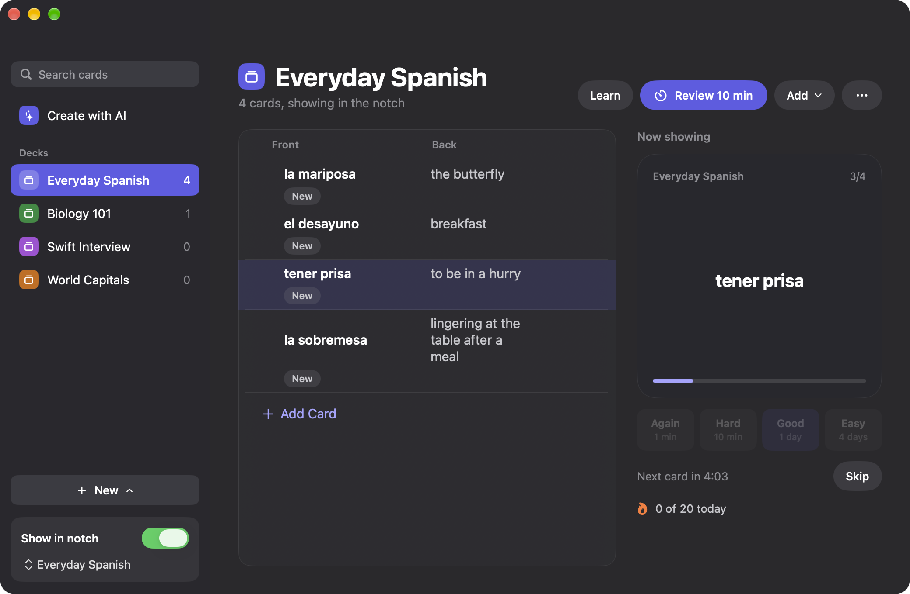

# FishBrain

[](https://github.com/phdz-ng/FishBrain/releases/latest)
[](https://github.com/phdz-ng/FishBrain/releases)
[](#install)
[](LICENSE)
[](https://github.com/phdz-ng/FishBrain/actions/workflows/ci.yml)

macOS flashcard app with an interactive WidgetKit widget. Requires macOS 14.0+.

**[Download FishBrain for macOS](https://github.com/phdz-ng/FishBrain/releases/latest/download/FishBrain-unsigned.dmg)**
· [All releases and notes](https://github.com/phdz-ng/FishBrain/releases)



## What it does

- **Desktop widget** in three sizes: one card at a time, click to flip, skip, one deck per widget.
- **Notch display**: move the pointer to the notch to see the current card (Macs without a notch get one drawn in the menu bar).
- **Decks and subjects**: group decks under subjects, search every card, paste or import cards.
- **Study your way**: grade cards (Again, Hard, Good, Easy), Learn mode, timed Review sprints, a streak and a daily goal.
- **Create with AI**: make cards from notes or a PDF with your own Anthropic or OpenAI key, or on your Mac with Apple Intelligence, and review them before saving.
- **Import and export** CSV files and Anki packages (.apkg).
- **Private**: your library stays on your Mac and API keys live in the Keychain.

## Install

1. **[Download FishBrain-unsigned.dmg](https://github.com/phdz-ng/FishBrain/releases/latest/download/FishBrain-unsigned.dmg)**
   (always the latest version; the release page shows the version, notes and checksum).
2. Open the DMG and drag **FishBrain** to **Applications**.
3. Open FishBrain. macOS will warn you the first time; see below.

Or build it yourself, as in the next section.

### The first time you open it

FishBrain is not signed with an Apple Developer ID (that needs a paid Apple Developer Program
membership), so macOS does not recognize the developer and warns you once. It is safe to open if you
downloaded it from this repository's Releases page.

**What you will see**

- **macOS 15 Sequoia or later:** a "Not Opened" dialog that says Apple could not verify FishBrain is
  free of malware, with only **Done** and **Move to Trash**. Click **Done**, then follow the steps below.
- **macOS 14 Sonoma:** a dialog that says FishBrain cannot be opened because the developer cannot be
  verified. If you Control-click the app and choose **Open**, you get "macOS cannot verify the developer
  of FishBrain. Are you sure you want to open it?" with an **Open** button.

The exact wording changes between macOS versions.

**How to allow it**

- **macOS 15 Sequoia or later:** open **System Settings > Privacy & Security**, scroll down to
  **Security**, and next to "FishBrain was blocked to protect your Mac" click **Open Anyway**. Confirm
  with your password or Touch ID, then click **Open**.
- **macOS 14 Sonoma:** Control-click (or right-click) **FishBrain** in Applications, choose **Open**,
  then click **Open** in the dialog.

After that, FishBrain opens normally like any other app.

**Check your download (optional).** Each release lists the DMG's SHA-256 checksum:

```sh
shasum -a 256 ~/Downloads/FishBrain-unsigned.dmg
```

The desktop widget depends on macOS loading an unsigned extension, which it may not do on every Mac
(see [Signing and App Group](docs/DEVELOPMENT.md#signing-and-app-group)); the main window and the notch work either way.

## Build

1. Install Xcode 15+ and [XcodeGen](https://github.com/yonaskolb/XcodeGen) (`brew install xcodegen`).
2. Generate the project (it is not checked in; `project.yml` is the source of truth):
   ```sh
   xcodegen generate
   open FishBrain.xcodeproj
   ```
3. Run the `FishBrain` scheme. In Debug builds, the launch argument `-FishBrainSampleData` (Product > Scheme > Edit Scheme > Run > Arguments) shows sample decks without touching your real library.

## Test

```sh
xcodebuild -project FishBrain.xcodeproj -scheme FishBrain -destination 'platform=macOS' test
```

CI (`.github/workflows/ci.yml`) builds the app and widget and runs the tests on every pull request
and every push to `main`.

## Documentation

- [How the features work](docs/FEATURES.md): copy to card, sharing decks, pictures, grading, streak, accessibility
- [Making cards with AI](docs/AI.md): providers, settings, the Create with AI screens
- [Development notes](docs/DEVELOPMENT.md): storage, the widget, signing and the App Group, targets
- [Releasing](docs/RELEASING.md) and the [changelog](CHANGELOG.md)
- [QA notes](docs/QA.md)

## Contributing

Bug reports and pull requests are welcome; see [CONTRIBUTING.md](CONTRIBUTING.md). Report security
problems privately, as described in [SECURITY.md](SECURITY.md).

## License

FishBrain is licensed under the [Apache License, Version 2.0](LICENSE). See [NOTICE](NOTICE).

FishBrain is an independent project. It is not affiliated with or endorsed by Anki, Anthropic or OpenAI.
Anki is a trademark of its respective owner. Anthropic, Claude and OpenAI are trademarks of their
respective owners and are named here only to describe the services the app can connect to.
